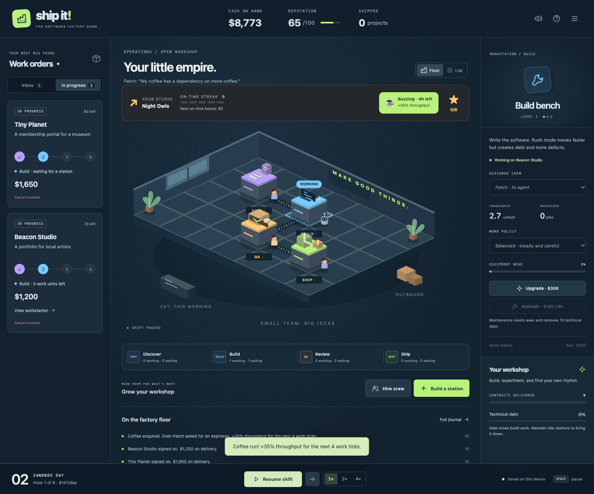
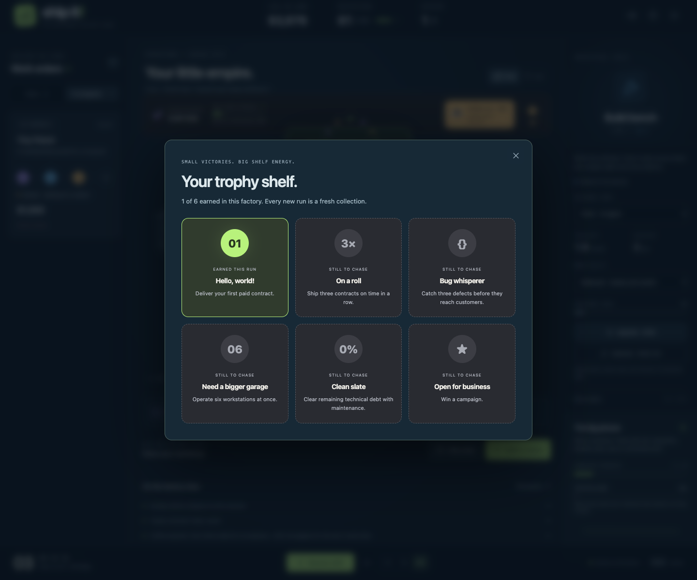

<div align="center">

# ship it!

**A small team. An unreasonable deadline. A suspicious amount of coffee.**

Turn a garage full of developers, robots, and questionable estimates into a software factory that actually ships.

[**▶ PLAY THE GAME**](https://hamanakam1.github.io/ship-it-game/) · [What's new in 1.1](CHANGELOG.md) · [Player guide](docs/PLAYER-GUIDE.md)

[](https://github.com/hamanakam1/ship-it-game/actions/workflows/pages.yml)
[](LICENSE)
[](package.json)


_Captured from the playable game. No account. No install. No purchases._

</div>

## The Good Work update

Pick a studio personality. Time a coffee run. Protect a shipping streak. Fill a trophy shelf. Then discover that the bug you rushed past review has a return address.

| Your studio         | Your unfair-ish advantage                                              | Try the same challenge                                                                                     |
| ------------------- | ---------------------------------------------------------------------- | ---------------------------------------------------------------------------------------------------------- |
| **$ Bootstrappers** | 15% lower crew wages. Spend the savings on something useful.           | [Play GOOD-WORK](https://hamanakam1.github.io/ship-it-game/?seed=GOOD-WORK&scenario=garage&studio=lean)    |
| **✓ Craft Club**    | Faster discovery and better defect detection. QA has entered the chat. | [Play GOOD-WORK](https://hamanakam1.github.io/ship-it-game/?seed=GOOD-WORK&scenario=garage&studio=craft)   |
| **↗ Night Owls**    | Faster shipping and package transport. One more release before bed.    | [Play GOOD-WORK](https://hamanakam1.github.io/ship-it-game/?seed=GOOD-WORK&scenario=garage&studio=express) |

- **Keep the streak alive.** On-time deliveries add increasing bonuses, capped at $200 per shipment. Late work and warranty claims break the streak.
- **Deploy the coffee.** Spend $80 for four working hours of +35% throughput. Time it around a busy floor; the next run is 16 hours away.
- **Collect six little victories.** First shipment, three-delivery streak, defect hunting, workshop expansion, debt cleanup, and a campaign win.
- **Enjoy the payoff.** Delivery stamps, confetti, crew banter, and optional sound give the workshop some life. Reduced motion is supported.

<details>
<summary><strong>Peek inside the workshop and trophy shelf</strong></summary>





</details>

## Your first five minutes

1. Start **Garage days** and pick a studio.
2. Accept two contracts. Your four starting workstations already have crew.
3. Start the shift. Watch the work travel through discovery, build, review, and shipping.
4. Use coffee while several people are working. Add capacity where a queue actually grows.
5. Get paid. Celebrate. Try to keep that streak alive.

**A challenge for your next run:** use seed `GOOD-WORK`, finish Garage days, and earn the three-delivery streak trophy. [Share your studio, best streak, and final report](https://github.com/hamanakam1/ship-it-game/issues/new?template=show-your-factory.yml). Scores are local and unverified; this is a friendly challenge.

## A factory with consequences

- **Place your production line.** Discovery desks, build benches, quality labs, and launch docks occupy a 7×5 workshop. Distance adds transport time.
- **Build your crew.** Developers are reliable generalists, agents build quickly, and QA engineers excel at review. Every station needs an assigned worker.
- **Choose your compromises.** Rush mode accelerates builds while creating more debt and defects. Thorough review takes longer and catches more mistakes.
- **Get paid for shipping.** Contracts pay on delivery. Payroll, rent, late fees, and warranty repairs compete for your runway.
- **Respond to the unexpected.** Scope changes, dependency outages, cleanup opportunities, and tempting shortcuts interrupt the shift.
- **See the whole story.** Live queues, a factory journal, daily cash trends, delivery history, and an end-of-run report explain what happened.

There are no real AI calls, accounts, purchases, analytics, or connected infrastructure. The factory is a fictional, deterministic game simulation.

## Three ways to play

| Scenario           | Starting cash | Objective                                                        |
| ------------------ | ------------: | ---------------------------------------------------------------- |
| Garage days        |        $3,000 | Deliver 6 contracts within 30 days                               |
| The Friday release |        $2,400 | Deliver 7 contracts within 20 days, with 45% more work per stage |
| Open workshop      |        $9,000 | Experiment without a campaign deadline or game-over condition    |

To win a campaign, also finish with at least 45 reputation, nonnegative cash, no active contracts, and no pending warranty claims. A balance below −$500 ends a campaign. Scores are local and unverified.

**First shift:** accept one or two contracts, start time, and watch the pipeline. The starting four stations already have crew. Expand where work actually accumulates.

## Run locally

Use Node.js 22.12+ or a newer supported release (CI uses Node 24).

```sh
npm ci
npm run dev
```

Open the local URL printed by Vite. No environment variables or service accounts are needed.

```sh
npm test          # deterministic simulation and save integrity tests
npm run build    # static production site in dist/
npm run preview  # serve that production build locally
npm run check    # syntax, tests, and production build
```

## Keep a factory, share a challenge

The game autosaves in your browser after each action and simulated hour. **Menu → Export save** downloads a portable JSON file. Importing validates it before replacing the current game. The simulation resumes paused.

**Share challenge** copies a link containing the scenario, studio, and seed. It reproduces the starting conditions, not the current factory. With the same game version, studio, seed, and sequence of actions at the same simulated hours, the outcome is deterministic.

Browser storage can be cleared or unavailable. Export a save if you want to keep a particular run. Starting a new factory replaces the single local autosave.

## Controls and accessibility

| Control     | Action                                         |
| ----------- | ---------------------------------------------- |
| Space       | Start or pause the shift                       |
| N           | Advance one hour while paused                  |
| B           | Open the workstation catalog                   |
| Escape      | Cancel placement or close a dismissible dialog |
| Tab / Enter | Navigate and activate controls                 |

Use **List** for a textual workstation view and grid placement controls. The layout adapts to phones and tablets. Sound is optional and off by default; gameplay never depends on it. Reduced motion follows your system preference and can also be selected in the menu. Opening a menu, encountering a decision, or hiding the browser tab pauses time.

## Under the hood

The game is dependency-free at runtime: plain ES modules, hand-authored SVG artwork, CSS, local storage, and optional Web Audio effects. Vite and Prettier are development tools only.

| File                   | Responsibility                                                                    |
| ---------------------- | --------------------------------------------------------------------------------- |
| `src/engine.js`        | Seeded simulation, actions, economy, routing, quality, events, save validation    |
| `src/data.js`          | Scenario, contract, worker, event, and workstation definitions                    |
| `src/floor.js`         | Isometric workshop and machine illustrations                                      |
| `src/flair.js`         | Studio choices, streak controls, trophy shelf, crew banter, delivery celebrations |
| `src/main.js`          | Controls, dialogs, onboarding, audio, persistence, and time playback              |
| `src/style.css`        | Desktop, tablet, mobile, and motion styles                                        |
| `tests/engine.test.js` | Simulation invariants, recovery, adversarial save input, campaign balance         |

See [simulation rules](docs/SIMULATION.md) for the exact model. It is designed for a strategy game, not for forecasting real team or model performance. The visible belts show the nearest downstream route for each station; dispatch selects available stations and calculates the actual package distance when work is assigned.

## Contribute a little good work

A fictional customer with a ridiculous deadline, a new crew quip, or a tiny machine animation is a great first contribution. Contract packs, scenarios, accessible interaction improvements, sound design, and artwork are welcome. Read [CONTRIBUTING.md](CONTRIBUTING.md) for the workflow and deterministic-model constraints.

The [release checklist](docs/RELEASE.md) covers the browser and campaign checks needed before shipping. GitHub Actions runs the checks and deploys the static build to GitHub Pages on a push to `main`.

All artwork, fictional customer names, and game sounds in this repository were created for this project. MIT licensed.
