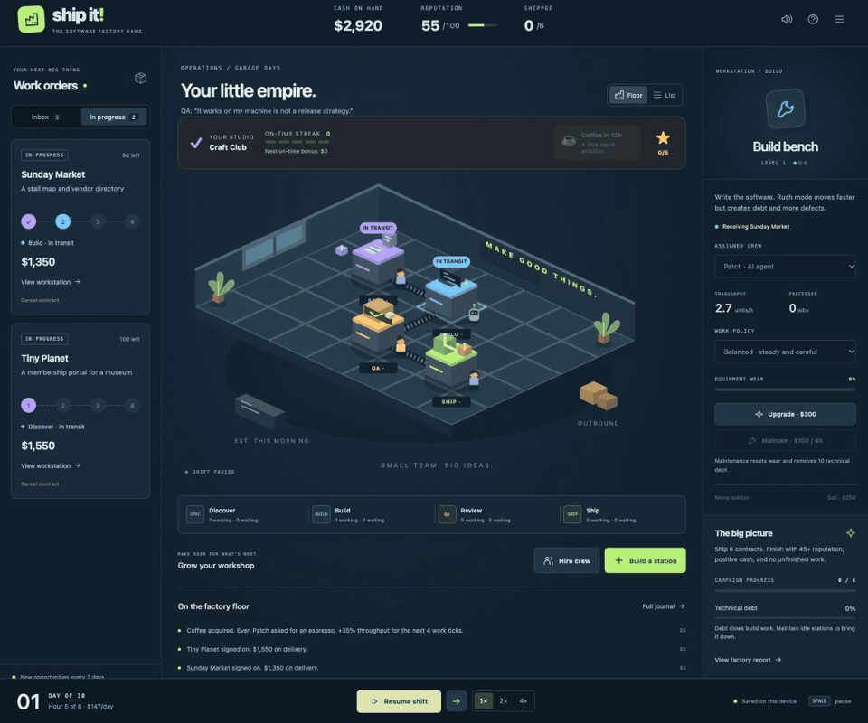

<div align="center">

# Ship It!

**Run a tiny software factory.**

Pick a job. Press Play. Get paid when it ships.

[**▶ Play in your browser**](https://hamanakam1.github.io/ship-it-game/) · [Player guide](docs/PLAYER-GUIDE.md) · [What's new](CHANGELOG.md)



Free. No account. No install. No purchases.

</div>

## How to play

1. Press **Start playing**. Your team is already hired.
2. Choose **Accept job** under a job you like.
3. Press **Play**. Your team plans, builds, checks, and ships it automatically.
4. Get paid, then choose another job.

The card above the factory tells you what to do next. Time pauses when the last job ships, unless customer checks or repairs are still pending.

**Your first goal:** ship six jobs in 30 game days. Finish with at least $0, 45 reputation, and no unfinished jobs or repairs. You can pause whenever you like.

## More to explore when you're ready

Press **More controls** to hire teammates, add workstations, buy coffee, and see your trophies. Use **Change game options** on the start screen to try different studios, a harder challenge, or a sandbox with no deadline.

Your game saves automatically in your browser. **Menu → Export save** lets you keep a copy. **Share challenge** copies a link with your starting conditions. Existing saves still work.

[Show your factory](https://github.com/hamanakam1/ship-it-game/issues/new?template=show-your-factory.yml) with a screenshot, seed, and the story of your run.

## Run locally

Use Node.js 22.12 or newer.

```sh
npm ci
npm run dev
```

Open the local address printed in the terminal. No API keys are needed.

```sh
npm run check    # formatting, syntax, tests, and production build
npm run preview  # preview the built game
```

## For contributors

Built with plain JavaScript, CSS, and SVG. No runtime dependencies or real AI calls. The simulation is fictional and deterministic for the same version, starting conditions, and actions.

- [Contributing](CONTRIBUTING.md)
- [Simulation rules](docs/SIMULATION.md)
- [Release checklist](docs/RELEASE.md)
- [MIT license](LICENSE)
